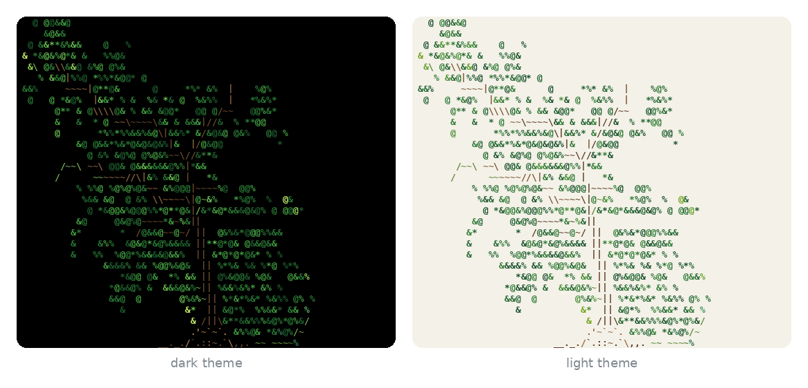

<div align="center">

# 🌱 Idle Garden

**Отойдите от компьютера — и на экране медленно вырастет ASCII-дерево.**<br>
Пошевелите мышью или нажмите любую клавишу — и оно исчезнет.


<sub>40 минут роста, ускоренные примерно до 14 секунд. Каждое дерево — новое.</sub>

<br><br>

**[Установка](#-установка) · [Windows](#-windows) · [Попробовать без установки](#-попробовать-сначала) · [Настройки](#%EF%B8%8F-настройки) · [English](README.md)**

</div>

---

Обычная заставка просто гасит экран. **Idle Garden** превращает время, пока вас нет, в то, к чему приятно вернуться:
из кусочка земли пробивается росток, вытягивается в ствол, раскидывает ветки, обрастает плющом —
и, если отойти надолго, заполняет листвой весь экран.

## ✨ Возможности

- 🌳 **Настоящее дерево, а не зацикленная анимация.** Ствол, крона, корявые ветки, свисающие лианы и плющ на стволе —
  каждый раз генерируются заново, одинаковых деревьев не бывает.
- 🐌 **Растёт медленно и неравномерно**, как живое: одни ветки вырываются вперёд, другие замирают и догоняют,
  рост идёт волнами. Весь экран зарастает примерно за 40 минут (настраивается).
- 🍃 **Живёт дальше.** Когда экран зарос, среди старых тёмных листьев продолжают распускаться новые яркие.
- 🌗 **Светлая и тёмная тема.** Сама подстраивается под тему системы — ночной сад или тушь на бумаге.
- 🪟 **Linux и Windows.** `.deb` для Ubuntu, `.exe` для Windows 10/11.
- 🖱️ **Мгновенно исчезает** при любом движении мыши, клике или нажатии клавиши. Сеанс не блокируется.
- 🎬 **Не мешает.** Не появляется, пока вы смотрите видео или сидите на созвоне.
- 🖥️ **На каждом мониторе** своё дерево.
- 🪶 **Лёгкий.** Чистый Python без pip-пакетов: GTK в Ubuntu, встроенный tkinter в Windows.
- 💻 **Бонус:** дерево можно вырастить прямо в терминале — `idle-garden --terminal`.

<p align="center"></p>

## 👀 Попробовать сначала

Без установки — просто один запуск из скачанной папки:

```bash
git clone https://github.com/DMgen10/idle-garden.git
cd idle-garden
python3 -m idle_garden --preview -g 2     # целое дерево за 2 минуты, на весь экран
python3 -m idle_garden --terminal -g 2    # …или в терминале
```

## 🚀 Установка

**Ubuntu / Debian / Mint / Pop!_OS** — как любая другая программа, через apt:

```bash
wget https://github.com/DMgen10/idle-garden/releases/latest/download/idle-garden.deb
sudo apt install ./idle-garden.deb
idle-garden --restart        # запустить сразу (иначе запустится при следующем входе)
```

**Любой другой Linux, без sudo** — только в домашнюю папку:

```bash
curl -fsSL https://raw.githubusercontent.com/DMgen10/idle-garden/main/install.sh | bash
```

Готово. Не трогайте компьютер **2 минуты** — и появится первый росток.
Все возможности: `man idle-garden` и `idle-garden --help`.

## 🪟 Windows

**Windows 10 / 11** — скачайте [`IdleGarden.exe`](https://github.com/DMgen10/idle-garden/releases/latest/download/IdleGarden.exe)
и запустите двойным щелчком. Это и есть вся установка: программа сама копируется в папку пользователя,
запускается при каждом входе в систему и добавляет в меню «Пуск» **Idle Garden** (предпросмотр)
и **Uninstall Idle Garden** (удаление). Права администратора и Python не нужны.

Или в PowerShell:

```powershell
irm https://raw.githubusercontent.com/DMgen10/idle-garden/main/install.ps1 | iex
```

> SmartScreen может показать *«Система Windows защитила ваш компьютер»*, потому что .exe не подписан —
> нажмите **Подробнее → Выполнить в любом случае**. Команда PowerShell выше такого окна не вызывает.
> Хотите из исходников? С установленным [Python](https://www.python.org/downloads/):
> `py -m idle_garden --preview -g 2`, а `py -m idle_garden --install` — чтобы запускалось вместе с Windows.

Настройки — в `%APPDATA%\idle-garden\config.ini` (`IdleGarden.exe --edit-config` откроет его в Блокноте).

## 🎮 Использование

| Команда | Что делает |
|---|---|
| `idle-garden --preview` | Показать дерево прямо сейчас (закрывается движением мыши) |
| `idle-garden --preview -g 2` | …и вырастить его за 2 минуты вместо 40 |
| `idle-garden --terminal` | Вырастить дерево в текущем терминале |
| `idle-garden --restart` | Перезапустить фоновую программу (после смены настроек) |
| `idle-garden --stop` | Остановить до следующего входа в систему |
| `idle-garden --check` | Проверить определение простоя и какая тема используется |
| `idle-garden --preview --theme light` | Посмотреть другую тему |

В меню приложений также появится **Idle Garden** — он открывает предпросмотр.

## ⚙️ Настройки

Файл `~/.config/idle-garden/config.ini` (в Windows — `%APPDATA%\idle-garden\config.ini`),
после правки — `idle-garden --restart`.

| Параметр | По умолчанию | Значение |
|---|---|---|
| `timeout` | `120` | Секунд без действий до появления ростка |
| `grow_minutes` | `40` | За сколько минут дерево заполнит весь экран |
| `font` / `font_size` | `auto` / `18` | Шрифт ASCII-графики (крупнее шрифт — крупнее листья); `auto` = Monospace / Consolas |
| `theme` | `auto` | `auto` — как в системе; или `dark` / `light` |
| `dark_background` | `#000000` | Фон тёмной темы |
| `light_background` | `#f4f1e8` | Фон светлой темы |
| `respect_inhibit` | `true` | Не запускаться, пока видео/звонок держат систему активной |
| `keep_screen_on` | `false` | Не давать Ubuntu гасить монитор, пока показано дерево |

> 💡 По умолчанию Ubuntu гасит экран через 5 минут (*Настройки → Электропитание → Отключение экрана*).
> Увеличьте это время или включите `keep_screen_on = true`, чтобы досмотреть, как дерево зарастает экран.

## 🔧 Как это работает

- **Время простоя** берётся у GNOME через D-Bus (`org.gnome.Mutter.IdleMonitor`) — работает и в Wayland, и в X11.
  На других X11-окружениях используется расширение XScreenSaver или `xprintidle`.
  В Windows — через `GetLastInputInfo`.
- Через `timeout` секунд простоя на каждом мониторе открывается полноэкранное окно без рамки
  (GTK в Linux, tkinter в Windows).
- **Тема** берётся из `color-scheme` Ubuntu (через XDG-портал или gsettings) и из «Режима приложений» Windows
  в реестре — заново при каждом появлении дерева, перезапуск не нужен.
- Форма дерева строится алгоритмом **space colonization**: по экрану разбрасываются тысячи точек (часть — сгустками,
  поэтому каждая крона по-своему несимметрична), и ветки тянутся к ним. У каждой ветки своя сила роста и свои паузы,
  лианы и плющ — закрученные случайные блуждания поверх.
- У каждого символа своё «время рождения»: дерево проявляется постепенно, молодые листья яркие, старые тёмные.
- Как только время простоя сбрасывается, окна закрываются. Это **не** блокировка экрана.

## ❓ Вопросы

**Заблокирует экран или спрячет мою работу?** Нет. Это просто окно поверх остальных, сеанс остаётся как был.

**Включится во время YouTube или Zoom?** Нет — программы, которые не дают системе уснуть, не дают и дереву вырасти
(отключается через `respect_inhibit = false`).

**Тема светлая, а дерево тёмное (или наоборот)?** Посмотрите `idle-garden --check`: в строке `theme` видно,
что сообщает система. Можно просто задать `theme = light` или `dark`.

**KDE / Sway / другие Wayland-окружения?** Пока нет: там нет общего способа узнать время простоя. PR приветствуются!

**Как удалить?** Windows: меню «Пуск» → **Uninstall Idle Garden**.
Если ставили `.deb`: `sudo apt remove idle-garden`.
Если скриптом: `curl -fsSL https://raw.githubusercontent.com/DMgen10/idle-garden/main/uninstall.sh | bash`
(допишите `-s -- --purge`, чтобы удалить и настройки).

## 📋 Требования

- **Linux:** Ubuntu 20.04+ (или другой Linux с GNOME, или любое X11-окружение), Python 3.8+ и GTK 3 —
  в Ubuntu Desktop уже установлены, иначе: `sudo apt install python3-gi python3-gi-cairo gir1.2-gtk-3.0`
- **Windows:** Windows 10 или 11. Для `.exe` больше ничего не нужно; для запуска из исходников — Python 3.8+.

Если понравилось — поставьте ⭐, так проект найдут и другие.

## 📄 Лицензия

[MIT](LICENSE)
